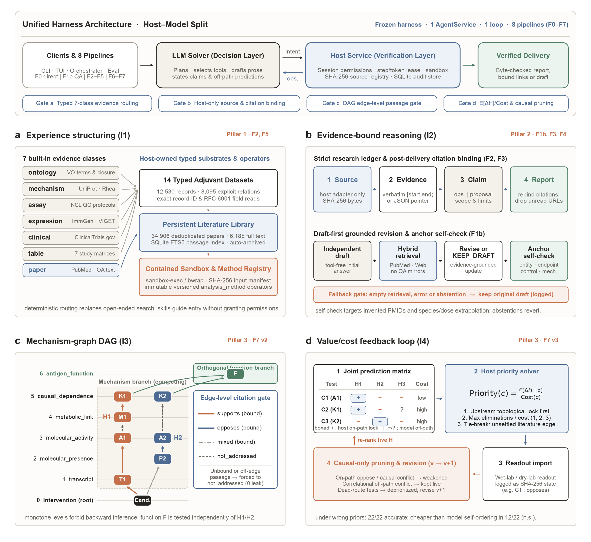

# AdjAgent

An evidence-grounded agent harness for vaccine adjuvant research.



*Top: one `AgentService` and one loop shared by every client and agent form; the model decides, the host verifies through four gates. (a) Typed evidence routing onto resource packs, a literature library and a sandbox; (b) host-registered sources, citation binding and draft-first revision; (c) a mechanism-graph DAG with an edge-level citation gate; (d) experiment ranking by expected eliminations per cost, with pruning on readouts.*

**Why.** Language models answer adjuvant questions fluently, but their answers mix supported and refuted statements and seldom name a source a reader can check. Adding tools or model roles does not fix this on its own: agents cite sources they never read, retrieval that rewrites every answer can make it worse, and a gain over the bare model may come only from the evidence it receives. AdjAgent is built around one rule instead: the model decides and writes, and the host verifies. The motivation and the mapping from evidence types to host gates are in [docs/architecture/HARNESS_ARCHITECTURE.md](docs/architecture/HARNESS_ARCHITECTURE.md#0-motivation).

AdjAgent separates decision from verification. A single agent loop lets the language model plan, call tools and write. A host service creates every source, binds claims to retrieved passages, gates citations and ranks experiments. The harness is organised around three capabilities:

- **P1 Experience integration.** Typed resource packs, a local literature library and sandboxed computation, used within one evidence-bound session.
- **P2 Evidence-bound reasoning.** Sources, verbatim evidence, claims and reports, with host-side citation binding and answer-preserving revision.
- **P3 Mechanism graphs.** Competing hypotheses as a directed acyclic graph with an edge-level citation gate; experiments ranked by expected eliminated hypotheses per unit cost; readouts propagated back into the graph.

This repository is the code-only release **release-v0.2**. Its harness code and pinned host files are identical to release-v0.1; v0.2 adds the architecture figure and the motivation. Results, evaluation sets and resource packs are not included (see [Availability](#availability)).

## Design invariants

- **One loop.** The CLI, the terminal UI, the workflow controllers and the evaluation runners drive the same `AgentService` and execution loop.
- **Host-created sources.** Papers, web pages, resource records and computation results enter only through host adapters, as immutable hashed artifacts. The model selects evidence and writes claims; it cannot create a source or mark its own claim as supported.
- **Session-scoped permissions.** Network access, file roots and tools are granted by explicit host options; profiles and prompts cannot widen them.
- **Evaluation isolation.** File tools refuse credential files and evaluation gold paths.
- **Fail closed.** An exhausted budget, an empty retrieval or a failed revision returns the draft with the reason recorded. Code runs only in a sandbox backend that has passed its containment self-test.

## Agent forms

Each agent form is a named pipeline in `adj_partner/pipelines/` with a fixed instruction set, tool list, budget and per-request limits.

| Form | Pipeline | Pillar | Task |
|---|---|---|---|
| F0 direct answer | `direct` | baseline | AdjQA-Fact; paired baseline arm of every task |
| F1b grounded QA revision | `qa-grounded-revision-v2` | P2 | AdjQA |
| F2 evidence-bound agent | `evidence-bound-v3` | P1 | AdjResource, AdjData |
| F3 research report | `research-report` | P2 | AdjDeepResearch |
| F4 short-form report | `research-report-quality` | P2 | AdjDeepResearch quality |
| F5 synthetic computation | `synth-execution` | P1 | AdjSynth |
| F6 guided reproduction | `guided-evidence-bound` | P3 | PLGA case (controlled) |
| F7 mechanism graph, grounding | `mechanism-graph-v2-grounding` | P3 | Mechanism retrospection |
| F7 mechanism graph, planning | `mechanism-graph-v3-planning` | P3 | Mechanism decision |

Pipeline settings can be inspected without a model:

```python
from adj_partner import pipelines

p = pipelines.for_slot('AdjResource')
pipelines.spec(p.name)['budget']     # frozen budget
pipelines.digest(p.name)[:12]        # settings digest, as recorded in harness_freeze.json
```

The layers, the host checkpoints and a code map are described in [docs/architecture/HARNESS_ARCHITECTURE.md](docs/architecture/HARNESS_ARCHITECTURE.md); the frozen configuration, task slots and replacement rules in [HARNESS_FREEZE.md](HARNESS_FREEZE.md).

## Availability

- **Included:** the harness, the pipelines, method skills and configuration, the terminal UI, the offline test suite, the frozen-configuration record (`harness_freeze.json`) and the publication checker.
- **Language:** documentation is in English. The frozen harness is released byte for byte, so some report labels, terminal UI text, the `adjuvant-design` method skill and multilingual test inputs contain Chinese; prompts and outputs default to English.
- **Not included:** experiment results and figures, to be released with the paper; the evaluation sets, gold answers and evaluation runners, available on request (open an issue); the typed resource packs, literature library, DEG data and the resource-pack entry guides, whose hashes are recorded in `harness_freeze.json`.

## Installation

Python 3.12 on macOS or Linux.

```sh
git clone https://github.com/gudehhh666/AdjAgent.git
cd AdjAgent
scripts/setup --python python3.12
scripts/adj-partner --state-dir harness-state --offline-demo tui   # scripted demo, no model call
```

To use a model, set `ADJ_LLM_API_KEY`, `ADJ_LLM_BASE_URL` and `ADJ_LLM_MODEL` in the private key file created by `scripts/setup` (`.einwang_env`, mode 600; all options in `.env.example`), then run `scripts/adj tui` or `scripts/adj doctor`.

Optional components: PDF table extraction and OCR need `adj_partner/native/requirements-pdf.txt` and Tesseract. Code execution needs macOS `sandbox-exec` (Python only) or Linux Bubblewrap with cgroup v2 delegation (Python and Bash); without a backend the analysis tools return `sandbox_unavailable`.

## Verification

```sh
.venv/bin/python -m pytest -q                      # offline suite
.venv/bin/python scripts/harness_freeze.py verify  # code and host files match the frozen record
.venv/bin/python scripts/harness_freeze.py slots   # task slots and their pipelines
.venv/bin/python scripts/check-publication.py      # path allowlist and credential scan
```

Tests that need withheld data, a sandbox backend or optional tools are skipped with the reason.

## Repository layout

```text
adj_partner/        harness: host service, agent loop, tools, scientific records, workflows
  pipelines/        frozen agent forms with settings digests
environment/        compatibility modules and deterministic computation dependencies
core/               shared helpers
config/             model, source and settings files; method skills in config/skills/
docs/architecture/  architecture description and overview figure
scripts/            setup, launchers, harness_freeze.py, check-publication.py
tests/              unit, integration, security-boundary and recovery tests
```

## Citation

```bibtex
@software{adjagent_2026,
  author  = {Wang, Xinming and Chen, Yi},
  title   = {{AdjAgent}: an evidence-grounded agent harness for vaccine adjuvant research},
  year    = {2026},
  version = {release-v0.2},
  url     = {https://github.com/gudehhh666/AdjAgent}
}
```

The accompanying paper is in preparation. GitHub's "Cite this repository" uses [CITATION.cff](CITATION.cff).

## License

Apache License 2.0; see [LICENSE](LICENSE).
