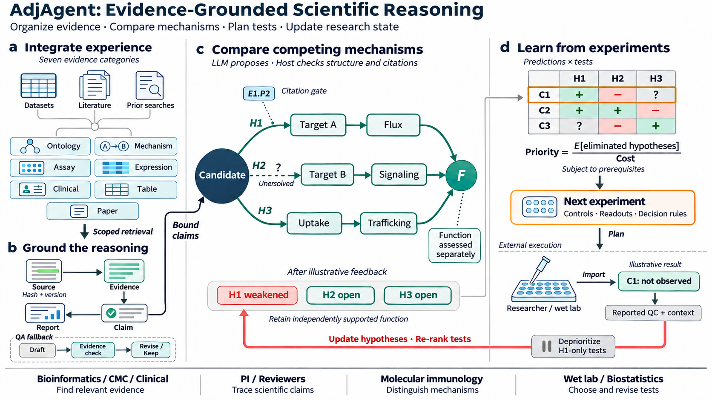
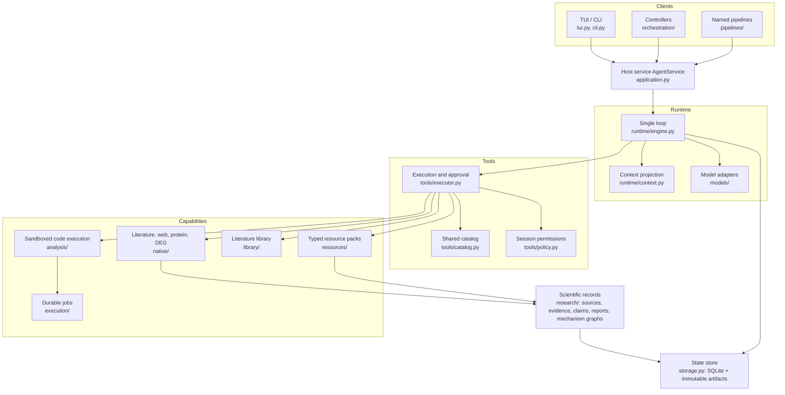
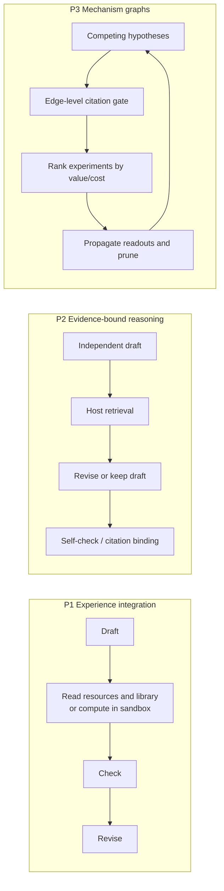

# AdjAgent architecture

AdjAgent consists of one host service, one agent loop and one shared tool catalog. Eight agent forms are built on this base, each registered as a named pipeline in `adj_partner/pipelines/`. The frozen configuration and replacement rules are in [HARNESS_FREEZE.md](../../HARNESS_FREEZE.md); installation is described in the [README](../../README.md).



## 1. Design principles

The model decides and writes; the host verifies sources, evidence, citations, experiment rankings and the final delivery.

- **One loop.** The CLI, the terminal UI, the workflow controllers and the evaluation runners share one `AgentService` and one execution loop.
- **Host-created sources.** Literature, web pages, resource records and computation results are registered by host adapters as immutable sources. The model selects evidence and writes claims; it cannot fabricate a source or label its own claim as supported.
- **Session-scoped permissions.** A tool definition in the catalog is not a grant. A profile is an instruction set and a list of tool names; it cannot enable network access, file roots or new tools.
- **Evaluation isolation.** File tools refuse evaluation sets, judge-only references and credential paths, so reference answers never enter the solver's context.
- **Registered versions.** Every workflow version is registered; frozen versions remain readable and must be allowed explicitly by new tasks.
- **Faithful failure.** An exhausted budget, an empty retrieval or a failed revision falls back to the draft and records the reason; there are no silent retries or format repairs.

## 2. Layers



| Layer | Modules | Responsibility |
|---|---|---|
| Clients | `cli.py`, `tui.py`, `orchestration/` | Submit tasks, show progress, resume and export; no decision logic |
| Host service | `application.py`, `profiles.py` | Create and resume sessions, tasks and runs |
| Runtime | `runtime/engine.py`, `runtime/context.py`, `models/` | Bounded durable loop: model decision, host tool execution, recorded result; context is a disposable projection |
| Tools | `tools/catalog.py`, `tools/executor.py`, `tools/policy.py` | Immutable tool definitions; exactly-once intent ownership, permission and budget checks, one-time approvals |
| Capabilities | `native/`, `resources/`, `library/`, `analysis/`, `execution/` | Literature search and full-text parsing, web reading, typed resource datasets, project literature library, sandboxed execution, durable computation jobs |
| Scientific records | `research/` | Sources, verbatim excerpts, versioned claims and reports, strict structural acceptance, mechanism graphs |
| Pipelines | `pipelines/` | One named pipeline per agent form: session instructions, tool list, budget, per-request limits and host steps; `spec(name)` and `digest(name)` |
| Orchestration | `orchestration/`, `task_modes/` | `TaskSpec`, workflow registry, `qa` / `design` / `discovery_design` modes, batch queue |
| Storage | `storage.py`, `trace_export.py` | Short-transaction SQLite with ordered audit events; consistent public trace export |

A run proceeds as follows: user input; task and run created in the session; execution lease acquired; goal, messages and tool snapshot projected; request persisted and one model call made; reply, permissions, schema, budget and lease checked; tools executed (as durable jobs, or after approval or user input where required); the tool-call group and its results written atomically; next decision; end of turn, or delivery of the original bytes after strict report re-verification.

## 3. Agent forms

All forms run on the same `AgentService` and differ in workflow, profile, tools and budget. `pipelines.for_slot(task)` returns the pipeline for an evaluation task.

| Form | Procedure | Pipeline and modules | Budget |
|---|---|---|---|
| F0 direct answer | One tool-free model call | `direct`; `pipelines/direct.py` | — |
| F1b grounded QA revision | Independent draft; hybrid retrieval (PubMed/PMC full text, Google Scholar, web; 6 pages read, 12 passages); revise or keep the draft; anchor self-check rewrite | `qa-grounded-revision-v2` (registered workflow); `orchestration/qa_grounded_v2_runtime.py`, `native/literature_search.py` | 2,400 output tokens per draft, revision and self-check |
| F2 evidence-bound agent | One session reading typed resource packs and the literature library, with sandboxed computation when needed | `evidence-bound-v3`; `pipelines/evidence_bound.py`, profile `research-evidence-bound` | 10 steps, 100k input tokens, 240 s |
| F3 research report | Tool-free draft; evidence-first session (web search, page reading, `evidence_read`); delivery fallback; citation binding to read passages | `research-report`; `pipelines/research_report.py`, `pipelines/citation_binding.py` | 16 steps, 150k input tokens, 900 s |
| F4 short-form report | F3 with a 1,200-word format, without claim and report tools or citation binding | `research-report-quality` | 12 steps, 80k input tokens, 480 s |
| F5 synthetic computation | Computation tasks executed as code in the analysis sandbox | `synth-execution`; `pipelines/synth.py` | 8–12 steps |
| F6 guided reproduction | Frozen task text with mechanism-keyword guidance in the session instructions; controlled reproduction, not a blind discovery | `guided-evidence-bound`; `pipelines/guided.py` | 16 steps, 150k input tokens, 900 s |
| F7 mechanism graph | Grounding: competing-path DAG with edge-level citation gate. Planning: adds a prediction matrix, ranking by expected eliminated hypotheses per cost, and readout propagation | `mechanism-graph-v2-grounding`, `mechanism-graph-v3-planning`; `pipelines/mechanism.py`, `research/mechanism_graph.py`, `task_modes/graph_grounding.py` | host gates only |

## 4. Pillars and feedback loops



| Pillar | Forms | Key modules | Tasks |
|---|---|---|---|
| P1 Experience integration | F2, F5 | `resources/`, `library/`, `analysis/`, `evidence_bound_entry.py` | AdjResource, AdjData, AdjSynth, AdjNER (appendix) |
| P2 Evidence-bound reasoning | F1b, F3, F4 | `orchestration/qa_grounded_v2_runtime.py`, `native/literature_search.py`, `answer_preserving.py`, `research/` | AdjQA, AdjDeepResearch, report quality (appendix) |
| P3 Mechanism graphs | F6, F7 | `research/mechanism_graph.py`, `task_modes/graph_grounding.py`, `orchestration/graph_grounding_runtime.py` | Mechanism retrospection, mechanism decision, PLGA case |

## 5. Host checkpoints

| Checkpoint | Host action | Module |
|---|---|---|
| Sources | Only host adapters register sources; content is stored as hashed immutable artifacts | `research/records.py`, `storage.py` |
| QA revision | Empty retrieval, failed revision or a refusal delivers the original draft and records the enhancement status | `orchestration/qa_grounded_v2_runtime.py` |
| Report citations | Every link must point to a source the agent read; binding aligns statements with passages; links to unread sources are removed | `pipelines/citation_binding.py`, `answer_preserving.py` |
| Mechanism edges | A cited passage that does not belong to the edge sets its status to "not addressed" | `task_modes/graph_grounding.py` |
| Experiment ranking | On-path predictions are derived from the graph; ranking by expected eliminations per cost; off-path elimination only along causal dependencies | `research/mechanism_graph.py` |
| Code execution | Inputs are manifested by path, type, size and hash and copied into the job; code writes only `outputs/` and `tmp/`; a backend that fails its self-test is refused | `analysis/sandbox.py` |
| Evaluation isolation | File tools refuse evaluation sets, judge-only references and credential paths | `tools/policy.py` |
| Budget | Steps, input and output tokens and wall time are accounted by the runtime | `runtime/engine.py` |

## 6. Freezing and extension

- The code fingerprint covers every `.py` file under `adj_partner/` and `environment/`; the non-Python files the harness reads are pinned separately. `scripts/harness_freeze.py verify` lists files changed since the freeze.
- An incumbent form is replaced only after a held-out gain over the direct answer (paired-difference CI above 0), or a strictly better verifiability metric without loss of quality; tuning uses the development split only.
- A new form needs a registered `Workflow`, a runtime in `task_modes/` or `orchestration/`, a named pipeline in `pipelines/`, and tests for success, refusal, cancellation, crash recovery and budget exhaustion.
- A new tool implements `ToolSpec` with `handler(context, **args) -> ToolResult` and is registered in the shared catalog; a session must grant it explicitly.

## 7. Code map

```text
adj_partner/
  application.py      host service AgentService
  runtime/            single loop, context projection, checkpoints, execution proofs
  models/             OpenAI-compatible interface, request projection, usage
  tools/              shared catalog, executor, session permissions
  execution/          durable jobs and recovery
  analysis/           sandboxed execution, method registry, analysis history
  native/             PubMed/PMC, Scholar and web, full-text parsing, protein, DEG
  resources/          typed resource packs, field reading, citation packets
  library/            project literature library (deduplication, FTS5 index)
  research/           sources, evidence, claims, report acceptance, mechanism graphs
  orchestration/      TaskSpec, workflow registry, controllers, batch queue
  pipelines/          named pipelines for the agent forms (settings, host steps, digests)
  task_modes/         qa, design, discovery_design, mechanism-graph literature status
environment/          compatibility modules and deterministic computation dependencies
scripts/              setup, harness_freeze.py, check-publication.py
tests/                unit, integration, security-boundary and recovery tests
```
